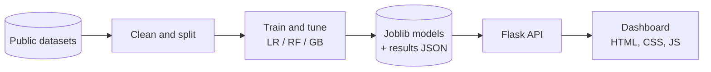

<div align="center">


# FORENSIC AI

**Explainable Android Malware Detection using static and network features**


[Live demo](#live-demo) · [Features](#features) · [Quick start](#quick-start) · [Documentation](#documentation) · [Citation](#datasets-and-references)

</div>

---

## Table of contents
1. [About](#about)
2. [Live demo](#live-demo)
3. [Features](#features)
4. [Screenshots](#screenshots)
5. [How it works](#how-it-works)
6. [Tech stack](#tech-stack)
7. [Project structure](#project-structure)
8. [Quick start](#quick-start)
9. [Usage](#usage)
10. [Results](#results)
11. [Testing](#testing)
12. [Deployment](#deployment)
13. [Documentation](#documentation)
14. [Limitations and responsible use](#limitations-and-responsible-use)
15. [Roadmap](#roadmap)
16. [Datasets and references](#datasets-and-references)
17. [License](#license) · [Author](#author)

## About
Security analysts receive far more suspicious Android applications than they can inspect by hand. **FORENSIC AI** is a decision-support
system that scores Android evidence as *benign* or *potentially malicious* and shows **which features drove each decision**.

It runs two independent experiments on two public, labelled datasets and serves the trained models through a Flask web application with an interactive dashboard.

> A score is a triage aid. It does **not** prove malicious intent or that malware executed.

## Live demo
<!-- Replace the placeholders below with your deployed link after following docs/DEPLOYMENT.md -->

| | |
|---|---|
| **Application** | `https://YOUR-APP-NAME.onrender.com` *(replace with your deployed URL)* |
| **Source code** | https://github.com/AMAN-AJWA-FATIMA/ForenSight-AI |
| **Hosted on** | *(Render / Hugging Face Spaces / PythonAnywhere)* |

## Features
- **Two independent experiments:** static features (permissions and API calls) and network-flow features, each with its own pipeline and model.
- **Honest evaluation:** split before preprocessing, group-aware splitting for network captures, cross-validated tuning on training data only, a single final test.
- **Three algorithms compared:** Logistic Regression, Random Forest and Gradient Boosting, baseline versus tuned.
- **Rich metrics:** accuracy, precision, recall, F1, specificity, false-positive and false-negative rates, ROC-AUC, PR-AUC, confusion matrices, ROC and precision-recall curves.
- **Explainability:** model importance, permutation importance and per-prediction explanations.
- **Interactive dashboard:** landing page plus five views (Dashboard, Dataset, Models, Explainability, Detect), light and dark themes.
- **Live detection:** analyse held-out test records, typed features or uploaded CSV files with the saved model.
- **Reproducible and tested:** fixed random seed, documented preprocessing log, automated test suite.

## Screenshots
<!-- Images are the same files used in the report (see reports/latex/SCREENSHOT_GUIDE.md). Add them once, they show here automatically. -->

| Landing page | Dashboard |
|---|---|
|  |  |
| **Models** | **Explainability** |
|  |  |

## How it works


| | Experiment A: Static | Experiment B: Network |
|---|---|---|
| Dataset | TUANDROMD (UCI #855) | CIC-AndMal2017 (UNB/CIC) |
| Evidence | Permissions and API calls (binary) | CICFlowMeter flow statistics |
| Unit | One application | One network flow |
| Split | Stratified train/test | Group-aware (by capture file) |
| Imbalance handling | Class weights, stratified folds | Class weights, stratified group folds |

The two datasets contain different applications, so the experiments are **never merged**.

## Tech stack
| Area | Tools |
|---|---|
| Language | Python 3 |
| Data and ML | pandas, NumPy, scikit-learn, joblib |
| Visualisation | Matplotlib, Seaborn (EDA), Chart.js (dashboard) |
| Backend | Flask (JSON API), Gunicorn (production) |
| Frontend | HTML5, CSS3, vanilla JavaScript |
| Quality | pytest |
| Report | LaTeX (Overleaf), python-docx |

## Project structure
```
ForenSight-AI/
├── backend/            Flask app factory and routes (pages + JSON API)
├── frontend/
│   ├── templates/      landing.html, index.html (dashboard) and partials
│   └── static/         css/, js/ (one script per view), img/logo.svg
├── src/
│   ├── preprocessing/  loaders and CIC-AndMal2017 flow builder
│   ├── models/         training/tuning and inference
│   └── evaluation/     metrics, EDA, explanations, dashboard data
├── notebooks/          01-04: EDA and modelling notebooks
├── scripts/            dataset download, helper and deployment scripts
├── reports/            Word and LaTeX report generators
├── tests/              pytest suite
├── docs/               datasets, deployment, Overleaf, submission notes
├── artifacts/          trained models and results (created by training)
├── datasets/           raw data (git-ignored, see Quick start)
├── requirements.txt    full development dependencies
└── requirements-deploy.txt   minimal runtime dependencies for hosting
```

## Quick start

### Prerequisites
Python 3.11 or newer, Git, and about 2 GB of free disk space for the datasets.

### 1. Install
**Ubuntu / Linux / macOS**
```bash
git clone https://github.com/AMAN-AJWA-FATIMA/ForenSight-AI.git
cd ForenSight-AI
python3 -m venv venv && source venv/bin/activate
pip install -r requirements.txt
```
**Windows (PowerShell)**
```powershell
git clone https://github.com/AMAN-AJWA-FATIMA/ForenSight-AI.git
cd ForenSight-AI
py -m venv venv
venv\Scripts\Activate.ps1        # if blocked: Set-ExecutionPolicy -Scope Process -ExecutionPolicy Bypass
pip install -r requirements.txt
```

### 2. Get the datasets
The repository contains **no data and no trained models**. Download the original public datasets:

| Dataset | Source | Place in |
|---|---|---|
| TUANDROMD | [UCI #855](https://archive.ics.uci.edu/dataset/855/tuandromd+(tezpur+university+android+malware+dataset)) | `datasets/static_analysis/TUANDROMD.csv` |
| CIC-AndMal2017 | [UNB/CIC](https://www.unb.ca/cic/datasets/andmal2017.html): the five `*-CSVs.zip` files | `datasets/network_analysis/raw/<Name>-CSVs/` |

```bash
python scripts/download_static_dataset.py        # static dataset (or download manually)
```
Extract the network archives (keep the folder names, they provide the labels):
```bash
# Linux / macOS
mkdir -p datasets/network_analysis/raw
for z in ~/Downloads/*-CSVs.zip; do unzip -oq "$z" -d "datasets/network_analysis/raw/$(basename "$z" .zip)"; done
```
```powershell
# Windows
New-Item -ItemType Directory -Force datasets\network_analysis\raw | Out-Null
Get-ChildItem "$HOME\Downloads\*-CSVs.zip" | ForEach-Object { Expand-Archive $_.FullName -DestinationPath "datasets\network_analysis\raw\$($_.BaseName)" -Force }
```
Then merge the flow CSVs into one table (100 flows per capture file keeps training fast):
```bash
python -m src.preprocessing.build_network_dataset --max-rows-per-file 100
```

### 3. Train and prepare the dashboard
```bash
python -m src.evaluation.eda --experiment both     # EDA figures -> reports/figures
python -m src.models.train --experiment both       # baseline + tuned models -> artifacts/
python -m src.evaluation.dashboard_data            # previews and samples for the dashboard
```
Everything in one command: `bash scripts/run_all.sh` (Linux/macOS) or `scripts\run_all.bat` (Windows).

### 4. Run
```bash
python -m backend.app
```
Open <http://127.0.0.1:5000> (landing page) or <http://127.0.0.1:5000/app> (dashboard). Press `Ctrl+C` to stop.

## Usage
**Dashboard views**

| View | Purpose |
|---|---|
| Dashboard | Key metrics, ROC curve, class split, top features, live analyses of real test records |
| Dataset | Raw to processed data, preprocessing steps, previews, key EDA chart |
| Models | Comparison table, ROC/PR curves, confusion matrices, train-vs-test check |
| Explainability | Global importance and the explanation of the latest analysis |
| Detect | Analyse a test record, typed features, or a CSV file |

**REST API** (`<exp>` is `static` or `network`)

| Method | Endpoint | Description |
|---|---|---|
| GET | `/api/health` | Whether each model loaded |
| GET | `/api/results` | Training and evaluation results |
| GET | `/api/dashboard-data` | Previews, EDA numbers and test samples |
| GET | `/api/<exp>/schema` | Feature names, top features, value ranges |
| POST | `/api/<exp>/predict` | JSON `{"features": {...}}`, JSON `{"records": [...]}` or a CSV upload (`file`) |

```bash
curl -X POST http://127.0.0.1:5000/api/static/predict \
     -H "Content-Type: application/json" \
     -d '{"features": {"<feature name>": 1}}'
```
Missing features in a `features` request use the training median; a CSV must contain every training feature column.

## Results
All numbers come from training on the real datasets and are stored in `artifacts/evaluation_results.json`. Generate the table for your run and paste it here:
```bash
python scripts/print_results_table.py
```
<!-- Paste the generated Markdown table below this line -->

| Experiment | Model (tuned) | Accuracy | Precision | Recall | F1 | FPR | ROC-AUC |
|---|---|---|---|---|---|---|---|
| *run the command above and paste the rows here* | | | | | | | |

★ marks the model selected by cross-validated F1 on the training split. Scores are on a held-out test set that was used once.

## Testing
```bash
python -m pytest -q
```
The suite uses tiny in-memory fixtures to check code paths (metrics, label cleaning, group-aware splitting, training outputs, API validation). They are never saved as data and no reported result comes from them.

## Deployment
The app is a long-running Python server, so it needs a Python host (not GitHub Pages). Step-by-step guides for **Render**, **Hugging Face Spaces** and **PythonAnywhere**,
including how to ship the trained models, are in [`docs/DEPLOYMENT.md`](docs/DEPLOYMENT.md). After deploying, put your link in the [Live demo](#live-demo) section.

## Documentation
| File | Contents |
|---|---|
| [`docs/DATASETS.md`](docs/DATASETS.md) | Dataset provenance, licences, known data-quality issues |
| [`docs/DEPLOYMENT.md`](docs/DEPLOYMENT.md) | Hosting guides and troubleshooting |
| [`docs/OVERLEAF.md`](docs/OVERLEAF.md) | Compile the LaTeX report on Overleaf |
| [`docs/SUBMISSION_NOTES.md`](docs/SUBMISSION_NOTES.md) | Rubric alignment and viva questions |
| [`reports/latex/SCREENSHOT_GUIDE.md`](reports/latex/SCREENSHOT_GUIDE.md) | Which screenshots to add to the report |

## Limitations and responsible use
- Triage only: a score is not proof of malicious intent, and a human analyst should review high-risk results.
- The static dataset has no application identifiers, so near-duplicate leakage cannot be excluded.
- Models reflect the data's collection period; new malware families can lower real-world accuracy.
- Labels come from the dataset creators and may contain errors. Static and network evidence are not combined for the same app.
- No malware is executed anywhere in this project. Do not use the tool as sole evidence against a person or developer.

## Roadmap
- [ ] Multi-class malware-family classification
- [ ] Newer datasets to test concept drift
- [ ] Repeated cross-validation with confidence intervals
- [ ] Combine static and network evidence when a shared-application dataset is available
- [ ] Calibrated decision thresholds based on an analyst's cost of errors

## Datasets and references
- P. Borah, D. K. Bhattacharyya. *TUANDROMD (Tezpur University Android Malware Dataset)*. UCI Machine Learning Repository. https://doi.org/10.24432/C5560H (CC BY 4.0)
- A. H. Lashkari, A. F. A. Kadir, L. Taheri, A. A. Ghorbani. "Toward Developing a Systematic Approach to Generate Benchmark Android Malware Datasets and Classification." *ICCST 2018*, IEEE. Dataset: https://www.unb.ca/cic/datasets/andmal2017.html
- F. Pedregosa et al. "Scikit-learn: Machine Learning in Python." *JMLR* 12:2825-2830, 2011.

## License
Source code is released under the [MIT License](LICENSE). The datasets keep their own licences; see [`docs/DATASETS.md`](docs/DATASETS.md).
