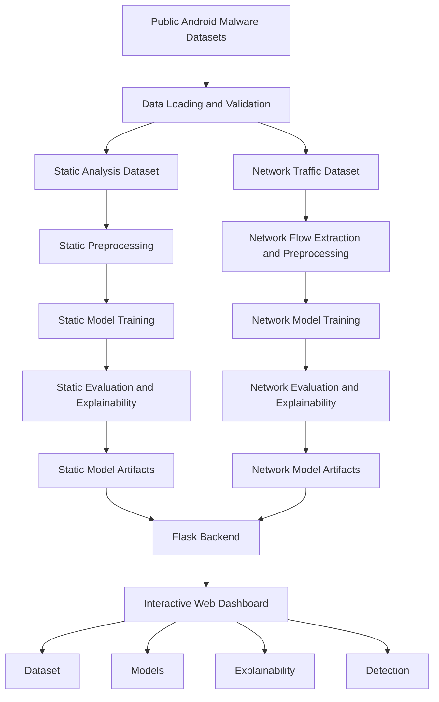

# 🛡️ ForenSight AI

### Machine Learning-Based Android Malware Detection

> Two independent ML pipelines. One explainable malware-triage dashboard.

[](https://forensight-ai-csit.vercel.app/)

[](https://github.com/AMAN-AJWA-FATIMA/ForenSight-AI)


---

---

## 📌 Overview

**ForenSight AI** is a machine-learning-based Android malware detection and analysis system designed to assess application behavior using two independent evidence sources:

- **Static analysis:** Android-related permissions and API-call indicators.
- **Network analysis:** Network-flow characteristics extracted from traffic using CICFlowMeter-compatible features.

The system integrates two independent binary classification pipelines into a single Flask application with an interactive dashboard. Users can explore datasets, inspect model performance, understand influential features, and submit data for prediction.

Each classifier distinguishes between:

- **Benign**
- **Potentially malicious**

The system is designed as a **malware-triage and analytical aid**, not as a definitive verdict on an application.

> ⚠️ A model prediction or probability score does not prove malicious intent, successful execution, or compromise. Predictions must be interpreted alongside additional forensic evidence.

---

## ✨ Key Features

| Feature                     | Description                                                                   |
| --------------------------- | ----------------------------------------------------------------------------- |
| 🔍 Static malware analysis  | Classification using permission and API-call-related indicators               |
| 🌐 Network malware analysis | Classification using network-flow statistical features                        |
| 🧠 Independent models       | Separate training, evaluation, and inference pipelines                        |
| 📊 Interactive dashboard    | Unified interface for datasets, models, results, and detection                |
| 📈 Model comparison         | Compare trained classifiers using evaluation metrics                          |
| 🔬 Explainability           | Inspect feature importance and prediction-related evidence                    |
| 🧪 Reproducible workflow    | Dataset loading, preprocessing, training, evaluation, and inference           |
| 🛡️ Evidence-aware output   | Predictions are presented as triage assessments rather than definitive claims |
| 🧰 CSV inference            | Submit structured feature data for batch prediction                           |
| 📝 Technical reporting      | Generate a technical report with figures and evaluation material              |

---

## 🧭 System Architecture

ForenSight AI maintains two separate analytical pipelines. Their datasets, feature spaces, training procedures, and evaluation results are not merged.



### Independent experiments

| Experiment      | Evidence source                                | Classification task             |
| --------------- | ---------------------------------------------- | ------------------------------- |
| **A — Static**  | Android permissions and API-related indicators | Benign vs potentially malicious |
| **B — Network** | CICFlowMeter-style network-flow statistics     | Benign vs potentially malicious |

These experiments are intentionally independent. Static and network data represent different evidence types and are not combined into a single training dataset.

---

## 🧪 Experiments and Datasets

### Experiment A — Static Analysis

**Dataset:** [TUANDROMD — Tezpur University Android Malware Dataset](https://archive.ics.uci.edu/dataset/855/tuandromd+%28tezpur+university+android+malware+dataset%29)

| Property         | Description                                        |
| ---------------- | -------------------------------------------------- |
| Source           | UCI Machine Learning Repository                    |
| Dataset ID       | 855                                                |
| Analysis type    | Static                                             |
| Feature evidence | Permission-related and API-call-related indicators |
| Task             | Binary classification                              |
| Split            | Stratified                                         |
| Label classes    | Benign / potentially malicious                     |

Static analysis examines features associated with an application without relying on live execution of the application.

**Important limitation:** The dataset does not provide sufficient application identifiers for reliable app-level deduplication. Near-duplicate leakage therefore cannot be ruled out.

---

### Experiment B — Network Analysis

**Dataset:** [CIC-AndMal2017](https://www.unb.ca/cic/datasets/andmal2017.html)

| Property               | Description                                    |
| ---------------------- | ---------------------------------------------- |
| Source                 | Canadian Institute for Cybersecurity (UNB/CIC) |
| Analysis type          | Network traffic                                |
| Feature representation | Network-flow statistics                        |
| Flow extraction        | CICFlowMeter-compatible CSV data               |
| Split                  | Group-aware, by capture file                   |
| Task                   | Binary classification                          |
| Label classes          | Benign / potentially malicious                 |

The network experiment uses traffic-derived features rather than Android permission or API-call features.

The original dataset contains categories including:

- Benign
- Adware
- Ransomware
- Scareware
- SMS malware

These malware categories are mapped into the binary classification task according to the project's preprocessing and labeling pipeline.

### Data provenance

ForenSight AI is built using real, publicly available datasets.

- No synthetic training dataset is generated.
- No fabricated evaluation samples are used to claim model performance.
- Dataset provenance, preprocessing decisions, and known issues are documented separately.

See [**`docs/DATASETS.md`**](docs/DATASETS.md) for dataset provenance, details, and limitations.

---

## 🤖 Machine Learning Methodology

The project follows a structured machine-learning workflow.

### 1. Data loading

- Load publicly available dataset files.
- Validate the input structure.
- Separate feature columns and target labels.
- Inspect class distribution and data quality.

### 2. Preprocessing

- Handle missing and invalid feature values.
- Convert feature data into usable numeric representations.
- Preserve the appropriate feature schema for each experiment.
- Prepare data for training and inference.

### 3. Model training

The training workflow evaluates baseline and candidate classifiers, including:

- Logistic Regression
- Random Forest
- Gradient Boosting

Model selection and tuning are performed using the project's training and evaluation procedures.

### 4. Evaluation

The models are evaluated using multiple complementary metrics:

| Metric           | What it measures                                     |
| ---------------- | ---------------------------------------------------- |
| Accuracy         | Overall proportion of correct predictions            |
| Precision        | Proportion of predicted positives that are positive  |
| Recall           | Proportion of actual positives detected              |
| F1-score         | Harmonic balance between precision and recall        |
| ROC-AUC          | Ranking performance across classification thresholds |
| Confusion Matrix | Breakdown of correct and incorrect predictions       |

Accuracy alone is not sufficient for malware detection because the cost of false negatives and false positives can differ substantially.

### 5. Model selection

The original network experiment and the improved network experiment are documented separately.

The improved network model was selected using the project's out-of-fold F1-based selection process and tuned decision threshold, with evaluation metrics reported on the test set.

### 6. Inference

At inference time, the backend:

1. Loads the relevant model artifact.
2. Validates the input feature schema.
3. Aligns input columns with the model's training feature order.
4. Converts feature values to numeric representations.
5. Handles missing values according to the pipeline's configured behavior.
6. Produces a prediction and malware probability.
7. Generates local explanation information for supported predictions.

---

## 📊 Network Model Improvement

The network classifier was improved in a separate experiment while preserving the original static classifier and the original network experiment for comparison.

### Original network model

| Metric    | Original model |
| --------- | -------------: |
| Model     |  Random Forest |
| Accuracy  |         60.99% |
| Precision |         27.80% |
| Recall    |         59.38% |
| F1-score  |         37.87% |
| ROC-AUC   |         65.53% |

### Improved network model

| Metric             |         Improved model |
| ------------------ | ---------------------: |
| Model              | Hist Gradient Boosting |
| Accuracy           |                 55.25% |
| Precision          |                 26.61% |
| Recall             |                 70.22% |
| F1-score           |                 38.59% |
| Features           |                     67 |
| Decision threshold |     Approximately 0.48 |

### Comparison

| Metric    | Original RF | Improved HGB |    Change |
| --------- | ----------: | -----------: | --------: |
| Accuracy  |      60.99% |       55.25% |  −5.74 pp |
| Precision |      27.80% |       26.61% |  −1.19 pp |
| Recall    |      59.38% |       70.22% | +10.84 pp |
| F1-score  |      37.87% |       38.59% |  +0.72 pp |

**Interpretation:** The improved Hist Gradient Boosting model achieves higher recall and a modestly higher F1-score on the reported test evaluation, while accuracy and precision decrease.

The model is therefore **not universally superior across every metric**. Its improvement reflects a different trade-off, with increased malware detection recall at the cost of more false-positive risk.

All metrics should be interpreted in the context of the dataset, its class distribution, the evaluation split, and the decision threshold.

---

## 🔬 Explainability

ForenSight AI includes explainability-oriented functionality to help users inspect evidence associated with model outputs.

The dashboard supports analysis of:

- Model-level feature importance
- Important predictive features
- Dataset feature distributions
- Model comparisons
- Prediction explanations for supported inference requests

Explainability is intended to help users investigate **why a model produced a particular assessment**.

Feature importance and explanations should not be interpreted as proof of causation or as independent forensic confirmation of malicious activity.

---

## 🖥️ Dashboard

The Flask application provides a unified interface for both experiments.

### Dashboard

An overview of the project and available analysis workflows.

### Dataset

Explore dataset statistics, feature distributions, samples, and relevant data summaries.

### Models

Compare trained models and their evaluation results, including relevant performance metrics and visualizations.

### Explainability

Inspect feature importance and evidence associated with model behavior.

### Detect

Submit feature data for static or network prediction and inspect the resulting assessment.

The dashboard's analysis mode allows users to switch between static and network evidence.

---

## 🗂️ Project Structure

```text
ForenSight-AI/
│
├── backend/
│   ├── app.py
│   └── routes.py
│
├── frontend/
│   ├── templates/
│   │   ├── index.html
│   │   └── partials/
│   │
│   └── static/
│       ├── css/
│       │   ├── style.css
│       │   └── landing.css
│       │
│       ├── js/
│       │   ├── core.js
│       │   ├── dashboard.js
│       │   ├── data.js
│       │   ├── models.js
│       │   ├── explain.js
│       │   ├── detect.js
│       │   ├── landing.js
│       │   └── app.js
│       │
│       └── img/
│
├── src/
│   ├── preprocessing/
│   │   ├── static loader
│   │   └── network dataset builder
│   │
│   ├── models/
│   │   ├── train.py
│   │   └── inference.py
│   │
│   ├── evaluation/
│   │   ├── metrics
│   │   ├── eda
│   │   ├── explain
│   │   └── dashboard_data
│   │
│   └── config.py
│
├── datasets/               # Local datasets; not committed
├── artifacts/              # Trained models and generated results
│   └── improved/            # Improved network experiment
│
├── notebooks/
│   ├── 01–04 EDA and modelling notebooks
│
├── reports/
│   ├── build_report.py
│   └── figures/
│
├── scripts/
│   ├── download_static_dataset.py
│   └── run_all.sh
│
├── docs/
│   ├── DATASETS.md
│   └── additional documentation
│
├── tests/
│
├── requirements.txt
├── README.md
└── .gitignore
```

> Generated datasets, trained model artifacts, and other large files are excluded from version control according to the project's `.gitignore` configuration.

---

## ⚙️ Installation

### Prerequisites

Recommended environment:

- Ubuntu Linux
- Python 3.12
- Git
- pip
- Internet access for dataset downloads

### 1. Clone the repository

```bash
git clone https://github.com/AMAN-AJWA-FATIMA/ForenSight-AI.git

cd ForenSight-AI
```

### 2. Create a virtual environment

```bash
python3.12 -m venv .venv

source .venv/bin/activate
```

### 3. Install dependencies

```bash
python -m pip install --upgrade pip

pip install -r requirements.txt
```

### 4. Verify the installation

```bash
python -m pytest -q
```

The test suite uses controlled fixtures and does not require downloading or training on the full datasets.

---

## 📥 Dataset Preparation

### Static dataset

Download the TUANDROMD dataset using the provided script:

```bash
python scripts/download_static_dataset.py
```

Expected location:

```text
datasets/
└── static_analysis/
    └── TUANDROMD.csv
```

If automated downloading fails, download the dataset manually from the [UCI repository](https://archive.ics.uci.edu/dataset/855/tuandromd+%28tezpur+university+android+malware+dataset%29) and place the CSV at the expected path.

---

### Network dataset

1. Visit the [CIC-AndMal2017 dataset page](https://www.unb.ca/cic/datasets/andmal2017.html).
2. Download the five CSV dataset archives:
   - Benign
   - Adware
   - Ransomware
   - Scareware
   - SMSmalware
3. Extract each archive while preserving its folder name.

Expected directory structure:

```text
datasets/
└── network_analysis/
    └── raw/
        ├── Benign-CSVs/
        ├── Adware-CSVs/
        ├── Ransomware-CSVs/
        ├── Scareware-CSVs/
        └── SMSmalware-CSVs/
```

### Build the network-flow dataset

For a smaller, faster experiment:

```bash
python -m src.preprocessing.build_network_dataset \
    --max-rows-per-file 100
```

This limits the number of flows extracted from each capture file to help control processing and training time.

Increase the limit when more data is desired and sufficient computational resources are available.

---

## 🚀 Training and Evaluation

### Exploratory data analysis

Generate EDA figures:

```bash
python -m src.evaluation.eda --experiment both
```

Figures are generated under:

```text
reports/figures/
```

Run an individual experiment:

```bash
python -m src.evaluation.eda --experiment static
```

or:

```bash
python -m src.evaluation.eda --experiment network
```

---

### Train models

Train both experiments:

```bash
python -m src.models.train --experiment both
```

Train only static models:

```bash
python -m src.models.train --experiment static
```

Train only network models:

```bash
python -m src.models.train --experiment network
```

The training workflow generates trained artifacts and evaluation results under the configured artifacts directory.

---

### Generate dashboard data

```bash
python -m src.evaluation.dashboard_data
```

This generates the supporting data used by the dashboard, such as dataset summaries, feature statistics, samples, and related information.

---

### Run the complete pipeline

```bash
bash scripts/run_all.sh
```

This script automates the configured workflow for data preparation, analysis, model training, and report generation.

> ⚠️ Network training can be computationally intensive. Training on larger datasets may take considerable time depending on dataset size, hardware, and model configuration.

---

## 🏃 Running the Application

Start the Flask application:

```bash
python -m backend.app
```

Open the application in your browser:

```text
http://127.0.0.1:5000
```

The dashboard provides access to:

- Dashboard overview
- Dataset analysis
- Model performance
- Explainability
- Detection interface

---

## 🔌 Backend API

ForenSight AI exposes JSON endpoints through its Flask backend.

| Endpoint               | Method | Purpose                                              |
| ---------------------- | ------ | ---------------------------------------------------- |
| `/api/health`          | GET    | Check the readiness of the static and network models |
| `/api/results`         | GET    | Retrieve static and network evaluation results       |
| `/api/dashboard-data`  | GET    | Retrieve dashboard data                              |
| `/api/network/schema`  | GET    | Retrieve network model feature schema                |
| `/api/static/predict`  | POST   | Perform static-feature inference                     |
| `/api/network/predict` | POST   | Perform network-feature inference                    |

The prediction endpoints accept structured feature input according to the relevant experiment's schema.

For CSV-based inference, the backend validates the required columns and aligns them with the model's training feature order.

### API response interpretation

Prediction responses may include:

- Predicted label
- Malware probability
- Number of processed rows
- Whether partial input was supplied
- Number of missing features filled
- Local explanation information for supported rows
- Triage disclaimer

The network model uses its configured decision threshold. A probability should not be interpreted as a guaranteed probability of real-world malicious intent.

---

## 🧪 Testing and Code Quality

Run the test suite:

```bash
pytest -v
```

Tests cover application routes, inference behavior, validation, model loading, missing-artifact handling, and compatibility of the improved network experiment with the results API.

---

## 📄 Technical Report

Generate the report:

```bash
python reports/build_report.py
```

The report generator produces:

```text
reports/ForenSight_AI_Technical_Report.docx
```

The report should be completed with:

- Dataset and methodology details
- EDA findings
- Model comparison
- Evaluation metrics
- Visualizations
- Interpretation of results
- Limitations
- Relevant application screenshots

The final report is intended to provide a detailed technical account of the project rather than simply presenting model scores.

---

## 🌐 Deployment

### Repository

[GitHub — ForenSight-AI](https://github.com/AMAN-AJWA-FATIMA/ForenSight-AI)

### Project demo

[ForenSight AI Demo](https://forensight-ai-csit.vercel.app)

Deployment availability and backend functionality may depend on the current hosting configuration.

The Flask backend requires a Python-compatible server environment. Static hosting alone cannot execute the Flask application or load its trained model artifacts.

For a complete hosted system, the frontend and backend must be configured to communicate with a reachable backend service, with the trained model artifacts available to the backend.

---

## 📁 Generated Artifacts

The project creates artifacts during data preparation, training, and evaluation.

Typical artifacts include:

- Trained model pipelines
- Feature schemas
- Evaluation metrics
- Confusion matrices
- ROC and precision-recall information
- Dataset summaries
- Feature importance data
- Dashboard samples and previews

Artifacts are generated locally from the datasets and training workflow.

The repository does not require committing large datasets or model files. If evaluation results are to be made available in the repository, only appropriate generated results should be committed, subject to project configuration and data-provenance requirements.

---

## ⚖️ Limitations

ForenSight AI has several limitations that must be considered when interpreting results.

### Dataset limitations

- The datasets represent specific collection periods and environments.
- Dataset labels and collection methodology may introduce bias.
- Malware behavior can evolve over time.
- Dataset performance may not generalize to applications or traffic outside the evaluated distributions.

### Static analysis limitations

- Static indicators do not necessarily reflect runtime behavior.
- The dataset does not provide sufficient app identifiers to reliably rule out near-duplicate leakage.
- Permission and API-call patterns can overlap between benign and malicious applications.

### Network analysis limitations

- Network-flow features do not directly identify the intent of an application.
- The dataset's capture environment may differ from real-world network conditions.
- Group-aware splitting by capture file helps reduce capture-level leakage but does not guarantee complete independence or generalization.
- The improved model trades accuracy and precision for increased recall.

### Machine-learning limitations

- Predictions depend on the quality and representativeness of the training data.
- A threshold changes the balance between false positives and false negatives.
- Feature importance does not establish causation.
- High or low confidence is not equivalent to forensic certainty.

### Operational limitations

- The system is not a substitute for malware sandboxing, reverse engineering, threat intelligence, or analyst investigation.
- Predictions should be corroborated using independent evidence.
- The system should not be used as the sole basis for security-critical decisions.

---

## 🔐 Data, Model, and Security Considerations

- Do not upload confidential or sensitive traffic captures without appropriate authorization.
- Treat predictions as untrusted analytical output.
- Do not execute suspected malware on ordinary personal or production systems.
- Use controlled, isolated environments for malware-related investigation.
- Keep local datasets and trained artifacts protected.
- Review the source and licensing conditions of datasets before redistribution.

---

## 📚 References

1. **TUANDROMD — Tezpur University Android Malware Dataset.** UCI Machine Learning Repository, Dataset 855.
   [https://archive.ics.uci.edu/dataset/855/tuandromd+%28tezpur+university+android+malware+dataset%29](https://archive.ics.uci.edu/dataset/855/tuandromd+%28tezpur+university+android+malware+dataset%29)

2. **CIC-AndMal2017.** Canadian Institute for Cybersecurity, University of New Brunswick.
   [https://www.unb.ca/cic/datasets/andmal2017.html](https://www.unb.ca/cic/datasets/andmal2017.html)

3. **scikit-learn Documentation.** Machine-learning models, evaluation metrics, and preprocessing.
   [https://scikit-learn.org/](https://scikit-learn.org/)

4. **Flask Documentation.** Web application framework.
   [https://flask.palletsprojects.com/](https://flask.palletsprojects.com/)

5. **Python Documentation.**
   [https://docs.python.org/3/](https://docs.python.org/3/)

---

## 👩‍💻 Project

**ForenSight AI**
Machine Learning-Based Android Malware Detection

Developed as an academic machine-learning project with emphasis on:

- Data analysis
- Machine-learning experimentation
- Android malware detection
- Model evaluation
- Explainability
- Backend development
- Interactive visualization
- Reproducible workflows

---

